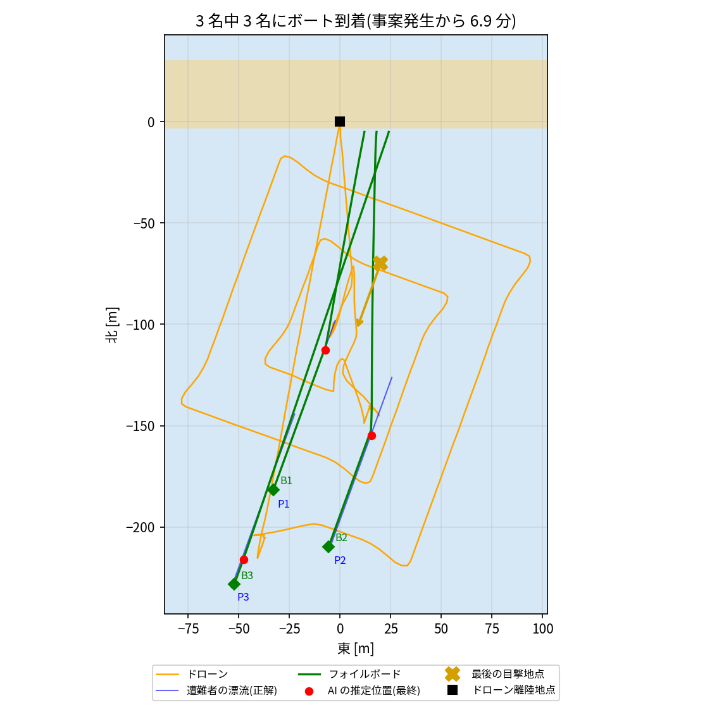

# AI 海難救助システム ― ドローンが見つけ、自律フォイルボードが駆けつける

Physical AI 応用講座1 の最終課題(海難救助版 `pai-ai-sea-rescue-drone`)を発展させたものです。WiCON 2026 の計画「自律航行ドローンとフォイルボードによる海難遭難者の早期発見および救助システム」を、シミュレーションで先に確かめます。

## 想定

名護市のシーグラスビーチで、遊泳者 3 名が離岸流で沖へ流されました。事案発生の 2 分後に、ドローンが砂浜から出動します。砂浜の水際には、自律航行するフォイルボードが 3 台待機しています。

## システムの動き

1. **ドローン**: 漂流予測 → 拡大方形捜索 → AI(YOLO11)で発見 → 降下して再確認。
2. **オペレータ**: 伝送された映像を確認して、救助を決定(GO)する。
3. **フォイルボード**: 一番近いボートが出動する。ドローンは遭難者の上空にとどまり、更新した位置を LoRa で毎秒送る。ボートは、遭難者が流れていく先を予測して向かい(先回り誘導)、離水して高速で航行する。手前 2 m で停止して浮体として待機し、発光マーカーを出す。
4. ボートが着いたら、ドローンは次の遭難者の捜索に戻る。全員にボートが着いたら帰還する。

## 使っている技術

- シミュレータ: PX4 SITL + Gazebo Harmonic
- 制御: ROS 2 Humble
- AI: YOLO11m(GPU で推論)


## デモ動画

本編は 2.5 倍速で、全体は 2 分 37 秒です。

## 結果(同じ条件で 3 回)

| 計画書の数値目標 | 結果(3 回) | 判定 |
|---|---|---|
| ボートの最終到着位置の誤差 2 m 以内 | 停止距離 2 m に対して +0.04〜+0.39 m(遭難者まで 2.04〜2.39 m) | ✓ |
| 座標伝送の遅延 100 ms 以内 | LoRa(SF7・125 kHz)の平均 85〜86 ms、最大 88 ms | ✓ |
| テレメトリの通信成功率 98% 以上 | 92.9%(パケットロス率 3% を設定。再送なし) | 要対策(再送・冗長化) |
| データ通信量 98% 削減 | 映像を送ったのは、候補を見つけてから GO までの 38〜51 秒だけ → 86〜89% 削減 | 要対策(静止画の利用など) |
| 事案発生から 5 分以内に救助 | 1 人目 2.9 分・2 人目 3.9 分・3 人目 6.9〜7.3 分 | 2/3 名 |
| AI の発見・確定 | 3 名全員を確定し、誤りは 0 件(誤検出の候補 1 件は棄却) | ― |

3 人目が 5 分を超えた理由は、事案発生からの時間の内訳(3 回目)で説明できます。

| 時刻 | 出来事 |
|---|---|
| 0〜120 s | 出動まで(ドローンの準備・離陸) |
| 137 s | 1 人目を発見 |
| 150 s | GO |
| 176 s | ボート到着(航行 26 秒) |
| 189 s | 2 人目を発見 |
| 234 s | ボート到着(航行 32 秒) |
| 234〜360 s | 3 人目を捜索(拡大方形捜索の外周) |
| 417 s | ボート到着(航行 44 秒) |

これは、計画書の構成の必要性を数値で示しています。

- **出動の待ち時間(120 秒)が、5 分のうち 4 割を占める**。ドローンを常に待機させるか、自動で離陸させる必要がある。
- **ドローン 1 機では、確認とボートを見守る間(計 84 秒)、捜索が止まる**。複数のドローン(親機と子機)で分担すれば、3 人目の発見を早められる。



## 計画書の構成との対応

| 計画書 | このシミュレーション |
|---|---|
| ドローンの機上で AI を動かし、遭難者を発見 | `detector`: YOLO11m のタイル分割推論(人が数十画素でも検出)、2 段階確認 |
| 候補を見つけたときだけ映像を LTE/5G で送る | `mission`: 映像を送るのは、候補の発見から GO までだけ。送った時間を記録 |
| 現場オペレータが目視確認して救助を決定 | `mission`: OPERATOR 状態(3 秒で GO とした) |
| ドローンが LoRa で座標をボートへ送る | `lora_link`: 送信時間(SF・帯域幅・ペイロード長から計算)+ 処理遅延 + パケットロス |
| ボートの方位の P 制御、離水、3 m 手前での停止シーケンス | `board`: 方位 P 制御、離水速度での離水、手前 2 m で逆転停止 → 浮体として待機 + 発光マーカー |
| 到着位置誤差 2 m 以内 | `truth_logger` + `tests/evaluate_mission.py` で、本当の位置と照合 |

計画書から変えた点、加えた点は次のとおりです。

- **ボートの速度**: 計画書の時速 40 km ではなく、最高時速 21.6 km(離水は時速 14.4 km から)にした。水中翼の設計(時速 10〜15 km で揚力が出る)と、スラスターの推力に合わせた現実的な値。
- **先回り誘導**: 遭難者は流され続けるので、「推定位置 + 海流 × (経過時間 + 到着までの時間)」を狙う。
- **座標の求め方**: ボートへ送る座標は、ドローンの位置ではなく、画像から求めた遭難者の位置(機体の姿勢とカメラの傾きを補正)。

## 動かし方

前提とセットアップは、海難救助版と同じです(`scripts/setup.sh`)。

```bash
./scripts/start_sim.sh     # 1. PX4 + Gazebo サーバー(ワールド sea_board)
./scripts/start_view.sh    # 2. Gazebo の 3D 画面
./scripts/start_ai.sh      # 3. ドローン + フォイルボード + LoRa の模擬 + 表示画面
python3 tests/evaluate_mission.py results/mission_YYYYMMDD_HHMMSS.json   # 評価
./scripts/stop_all.sh      # 停止
```

ボートの性能(最高速度・離水速度・停止距離・方位ゲインなど)と LoRa の条件(SF・パケットロス率)は、`ros2_ws/src/ai_patrol/config/params.yaml` で変えられます。

## ファイル構成

```
ros2_ws/src/ai_patrol/ai_patrol/
  detector_node.py    AI 検出(YOLO11 タイル推論、画素 → 海面上の位置)
  mission_node.py     ドローン: 漂流予測・拡大方形捜索・確認・GO・ボート誘導
  board_node.py       フォイルボード(複数台): 先回り誘導・方位 P 制御・離水・停止・浮体待機
  lora_link_node.py   LoRa 無線リンクの模擬(送信時間・遅延・パケットロス・統計)
  dashboard_node.py   表示画面
worlds/make_world.py  ワールド(漂流する遊泳者・ボート・発光マーカー)
scripts/truth_logger.py  評価用に本当の位置を記録(AI と制御には渡さない)
tests/evaluate_mission.py 計画書の数値目標に対応する評価
results/              3 回分の報告書と本当の位置の記録
```

## ライセンス

コードは MIT ライセンスです。YOLO11 の重み(AGPL-3.0)はリポジトリに含めません。
