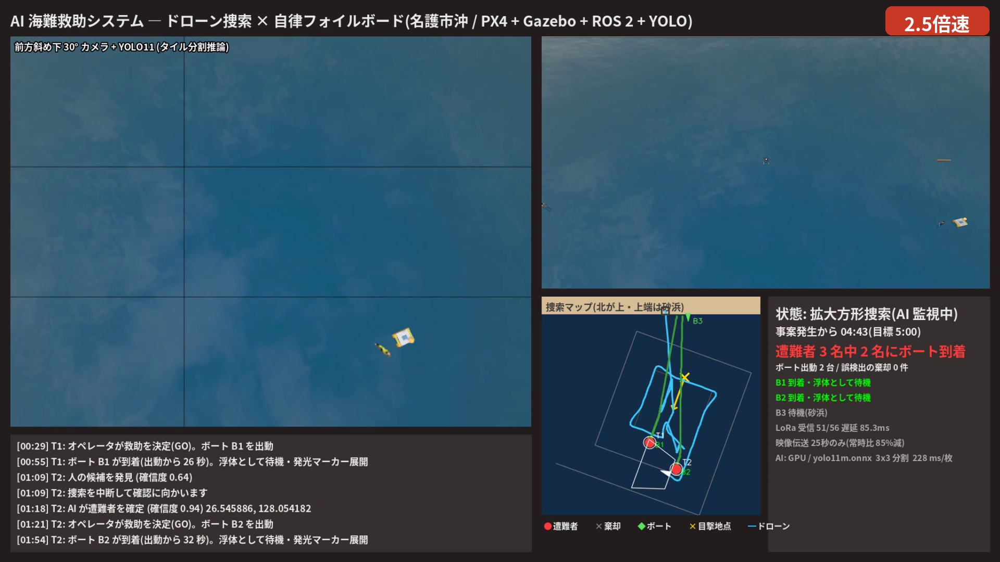
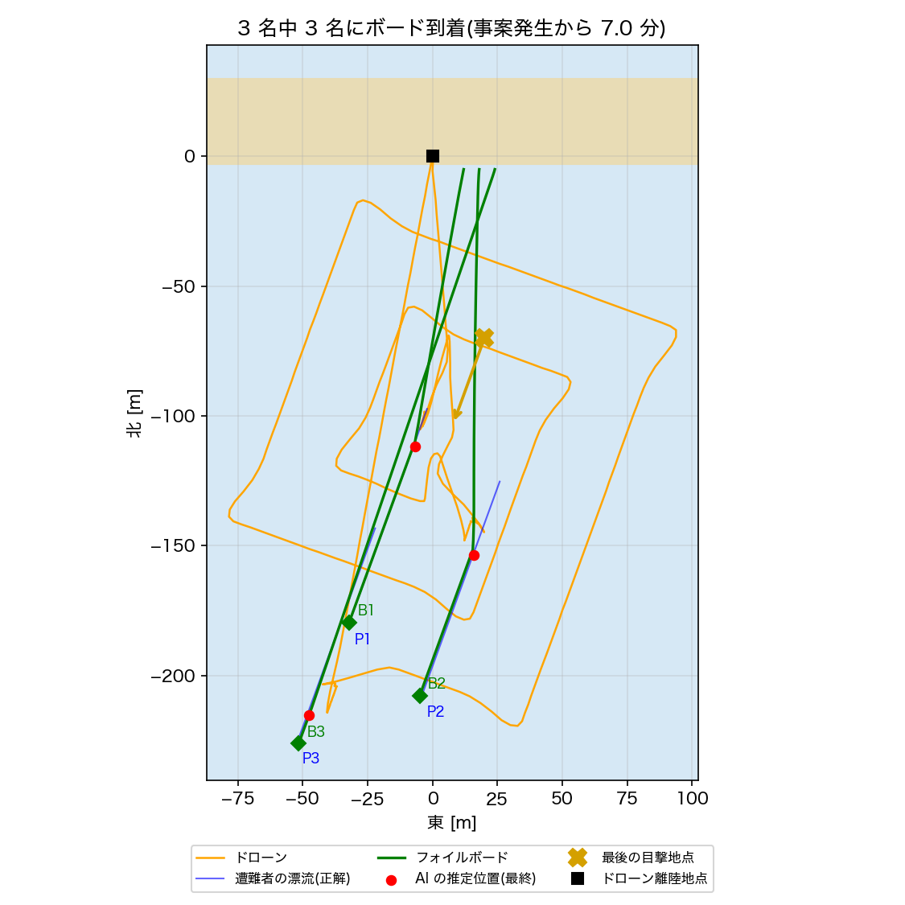

# AI 海難救助システム ― ドローンが見つけ、自律フォイルボードが駆けつける

Physical AI 応用講座1 の最終課題である(omnicampus アカウント: ba2vwbus)。ドローンが AI(YOLO11m)で遭難者を見つけ、無人のフォイルボードが遭難者のもとへ駆けつける。PX4 SITL・Gazebo Harmonic・ROS 2 Humble の上で動かしている。

- 説明資料: [docs/説明資料.pdf](docs/説明資料.pdf)
- 解説資料: [レポート編](docs/解説資料_レポート編.pdf)(想定・工夫・結果の詳しい説明、38 ページ)、[実装編](docs/解説資料_実装編.pdf)(プログラムの中身、43 ページ)
- デモ動画: [YouTube「PAI最終課題_ba2vwbus」](https://youtu.be/CmVHoU2eICE)(2 分 50 秒。本編は 2 倍速)



## 想定

沖縄県名護市の海水浴場で、遊泳者 3 名が離岸流で沖へ流された。事案発生の 2 分後に、ドローンが砂浜から出動する。砂浜の水際には、無人で走るフォイルボードが 3 台待機している。ドローンが事前に知っているのは、最後の目撃地点と海流の予報(0.25 m/s・方位 200°)だけである。

## システムの動き

1. **ドローン**: 漂流予測 → 拡大方形捜索 → AI(YOLO11m)で発見 → 高度 10 m に降りて再確認。
2. **オペレータ**: 伝送された映像を見て人だと確かめ、ボードを発進させる。
3. **フォイルボード**: 一番近いボードが発進する。ドローンは遭難者の上空にとどまり、更新した位置を LoRa で毎秒送る。ボードは、遭難者が流れていく先を予測して向かい(先回り誘導)、離水して航行する。手前 2 m で止まって浮き具の代わりになり、発光マーカーを出す。
4. ボードが着いたら、ドローンは次の遭難者の捜索に戻る。全員にボードが着いたら帰還する。

## 結果(同じ条件で 3 回)

| 項目 | 1 回目 | 2 回目 | 3 回目 |
|---|---|---|---|
| 発見・確定した遭難者(誤り) | 3 名(0) | 3 名(0) | 3 名(0) |
| 見つけた順 | P1 → P2 → P3 | P1 → P2 → P3 | P1 → P3 → P2 |
| ボード到着(事案発生から。1・2・3 人目) | 175・234・417 s | 175・266・417 s | 175・240・326 s |
| ボードの航行時間(1・2・3 人目) | 26・32・44 s | 26・33・44 s | 26・36・36 s |
| ボードと遭難者の距離(停止距離 2 m) | 1.93〜2.23 m | 1.58〜2.16 m | 1.69〜2.24 m |
| LoRa の受信数 / 送信数 | 94 / 98 | 95 / 99 | 93 / 94 |
| LoRa の遅延(平均 / 最大) | 85.0 / 86.7 ms | 86.7 / 89.8 ms | 82.5 / 86.4 ms |
| 映像を送った時間 / 飛行時間 | 38 / 343 s | 38 / 346 s | 38 / 247 s |

- 1 人目と 2 人目には、目標の 5 分(300 s)以内にボードが着いた。3 人目は 326〜417 s かかった。
- 3 人目の時間は、見つける順番で変わる。3 回目は、1 人目のボードが着いた直後に P3 を P2 より先に見つけたので、ほかの回より 91 s 早かった。
- ボードの航行は 44 s 以内で、遅れの原因ではない。時間を使っているのは、出動前の待ち 120 s と、ドローン 1 機で確認と見守りを順番にこなす間(1・2 人目で計 83 s)に捜索が止まることである。
- LoRa のパケットロスは 3% で、捨てるパケットは実行のたびに違う乱数で決める(使った乱数の種は報告書の `lora.seed` に記録)。パケットを失っても、次の座標で誘導が続くので、到着の精度は変わらなかった。



## 工夫した点

- **漂流予測**: 目撃地点ではなく「目撃地点 + 海流 × 経過時間」を中心に、拡大方形捜索を行う。
- **タイル分割推論**: 画像を 3×3 に分けて推論し、高度 18 m から小さく写る人を見落とさない。
- **2 段階の確認**: 確信度 0.45 で候補、高度 10 m に降りて 0.60 以上が 2 回で確定。確認できなければ棄却する。
- **人が最後に判断する**: ボードを発進させるかどうかはオペレータが決める。映像を送るのは、候補の発見からボードの発進までの間だけと仮定した。その時間は飛行時間の 11% で、常に送る場合と比べて送る時間は 89% 短い。映像のビットレート・遅れ・途切れは模擬しておらず、送る時間を数えただけである。
- **先回り誘導**: 「推定位置 + 海流 ×(今 − 推定時刻 + 到着までの時間)」の 2 m 手前を狙う。
- **時刻を正しく付ける**: 検出した位置には「写真を受け取った時刻」を付け、推論にかかった時間の分だけ予測がずれないようにする。
- **正解は評価だけに使う**: 遭難者とボードの本当の位置は、評価専用の `truth_logger` だけが記録する。

## 使っている技術

- シミュレータ: PX4 SITL v1.18 + Gazebo Harmonic 8
- 制御: ROS 2 Humble(Micro XRCE-DDS で PX4 とつなぐ)
- AI: YOLO11m(ONNX、onnxruntime-gpu で推論)
- 動作環境: Ubuntu 22.04 + RTX 3060

## 動かし方

初回だけ `scripts/setup.sh` を実行する(Ubuntu 22.04 + ROS 2 Humble + PX4 + Gazebo Harmonic を構築済みが前提)。モデル・ワールド・機体設定の登録と、ビルドを行う。

```bash
./scripts/start_sim.sh     # 1. PX4 + Gazebo サーバー(ワールド sea_board)
./scripts/start_view.sh    # 2. Gazebo の 3D 画面
./scripts/start_ai.sh      # 3. ドローン + フォイルボード + LoRa の模擬 + 表示画面
python3 tests/evaluate_mission.py results/mission_YYYYMMDD_HHMMSS.json   # 評価
./scripts/stop_all.sh      # 停止
```

注意: 遭難者は Gazebo を起動した瞬間から流れ始める。1 から 3 までを約 30 秒以内に続けて起動すること。遅れると、遭難者がその分だけ沖へ流れ、捜索範囲の外に出ることがある。

録画しながら実行する場合は `scripts/record_demo.sh`、動画の編集は `SPEED=2 scripts/make_video.sh 録画.mp4 報告書.json` である。

ボードの性能(最高速度・離水速度・停止距離・方位ゲインなど)と LoRa の条件(SF・パケットロス率・乱数の種)は、`ros2_ws/src/ai_patrol/config/params.yaml` で変えられる。

## ファイル構成

```
ros2_ws/src/ai_patrol/ai_patrol/
  detector_node.py    AI 検出(YOLO11 タイル推論、画素 → 海面上の位置)
  mission_node.py     ドローン: 漂流予測・拡大方形捜索・確認・ボードの発進・見守り
  board_node.py       フォイルボード(複数台): 先回り誘導・方位 P 制御・離水・停止・浮体待機
  lora_link_node.py   LoRa 無線リンクの模擬(送信時間・遅延・パケットロス・統計)
  dashboard_node.py   表示画面
worlds/make_world.py  ワールド(漂流する遊泳者・ボード・発光マーカー)
scripts/truth_logger.py  評価用に本当の位置を記録(AI と制御には渡さない)
tests/evaluate_mission.py 報告書と本当の位置を照合して評価
results/              3 回分の報告書(board_run*.json)と本当の位置の記録(truth_run*.jsonl)
docs/                 説明資料・解説資料(レポート編・実装編)
```

## ライセンス

コードは MIT ライセンスである。YOLO11 の重み(AGPL-3.0)はリポジトリに含めない。
